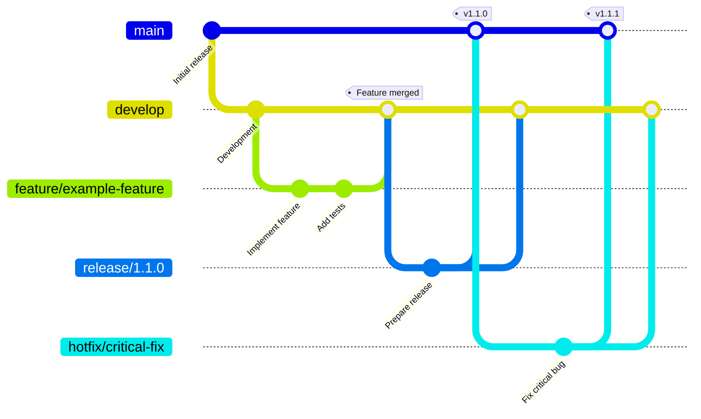

# Contributing

First of all, thank you for considering contributing to this project! Every contribution is appreciated, whether it's a bug report, a feature suggestion, documentation improvements, or code.

The goal is to make contributing as straightforward as possible.

## Getting Started

Before contributing, please take a moment to:

1. Check the existing [issues](../../issues) to see whether the problem or idea has already been reported.
2. Look through existing [pull requests](../../pulls) to avoid duplicate work.
3. Read this guide to understand the contribution process.

If you're unsure about anything, feel free to open an issue and ask.

## Reporting Bugs

If you find a bug, please open an issue and include as much relevant information as possible:

- A clear and descriptive title.
- Steps to reproduce the problem.
- What you expected to happen.
- What actually happened.
- Relevant logs, screenshots, or error messages.
- Your environment, if relevant (e.g. operating system, runtime version, or application version).

Please make sure the issue hasn't already been reported.

## Suggesting Features

Feature suggestions are welcome!

When opening a feature request, please explain:

- The problem you're trying to solve.
- Your proposed solution or idea.
- Any alternatives you've considered.
- Why the feature would be useful to the project.

For larger changes, it's best to open an issue for discussion before starting implementation.

## Submitting Changes

Pull requests are the preferred way to contribute code.

1. Fork the repository.
2. Create a branch for your changes.
3. Make your changes, keeping them focused and easy to review.
4. Run the relevant tests and checks.
5. Commit your changes with a clear and descriptive commit message.
6. Push your branch to your fork.
7. Open a pull request against the appropriate branch of this repository.

Please provide a short description of what your pull request changes and why.

If your pull request addresses an existing issue, link it in the description (e.g. `Closes #123`).

## Branching Strategy

This project follows a Git Flow-inspired branching strategy to keep development, releases, and maintenance organized.

### Branch Overview

- `main`: Stable, released code.
- `develop`: Integration branch for the next release.
- `feature/*`: New features, branched from `develop`.
- `bugfix/*`: Non-urgent bug fixes, branched from `develop`.
- `release/*`: Release preparation, branched from `develop`.
- `hotfix/*`: Urgent fixes for released versions, branched from `main`.

### Branching Diagram

The following diagram illustrates the typical workflow:



The diagram shows a simplified example. All changes must go through the appropriate pull request and review process. Temporary branches should be deleted after merging.

### Getting Started

First, clone the repository and switch to `develop`:

```bash
git clone https://github.com/dominikgobel/kern.git
cd REPOSITORY

git fetch origin
git switch develop
git pull origin develop
```

### Creating a Feature Branch

Create a dedicated branch from the latest `develop` branch:

```bash
git switch develop
git pull origin develop

git switch -c feature/my-feature
```

Implement your changes and commit them using the project's commit convention:

```bash
git add .
git commit -m "feat: add my feature"
```

Push the branch to GitHub:

```bash
git push -u origin feature/my-feature
```

Then open a pull request targeting `develop`.

### Creating a Bugfix Branch

For non-urgent bug fixes, branch off `develop`:

```bash
git switch develop
git pull origin develop

git switch -c bugfix/fix-description
```

After implementing and testing the fix:

```bash
git add .
git commit -m "fix: resolve the reported issue"
git push -u origin bugfix/fix-description
```

Open a pull request targeting `develop`.

### Preparing a Release

Release branches are created by maintainers when `develop` is ready for a new release.

```bash
git switch develop
git pull origin develop

git switch -c release/1.1.0
git push -u origin release/1.1.0
```

Only release-related changes should be made on this branch, such as version updates, changelog entries, and final bug fixes.

Once the release is approved:

1. Merge `release/1.1.0` into `main` through a pull request.
2. Create a Git tag for the release.
3. Merge the release branch back into `develop` through a pull request.

For example, after the release has been merged into `main`, a maintainer can create and push the tag:

```bash
git switch main
git pull origin main

git tag -a v1.1.0 -m "Release v1.1.0"
git push origin v1.1.0
```

### Creating a Hotfix Branch

Hotfixes are reserved for urgent problems affecting a released version. They are branched from `main`.

```bash
git switch main
git pull origin main

git switch -c hotfix/critical-fix
```

After implementing and testing the fix:

```bash
git add .
git commit -m "fix: resolve critical production issue"
git push -u origin hotfix/critical-fix
```

Open a pull request targeting `main`. After approval, the maintainer merges the hotfix, creates the appropriate patch release tag, and ensures the fix is also merged into `develop`.

### General Rules

- Direct commits to `main` and `develop` are not permitted.
- All changes must be submitted through pull requests.
- Feature and bugfix pull requests target `develop`.
- Release and hotfix pull requests target `main` when preparing a release or fixing a released version.
- Release branches must also be merged back into `develop`.
- Hotfixes must be propagated to `develop` to prevent regressions.
- All required CI checks must pass before merging.
- Temporary branches should be deleted after they have been merged.

Maintainers are responsible for reviewing contributions, coordinating releases, and ensuring that branches remain consistent.

## Code Quality

Please keep the following guidelines in mind:

- Follow the existing code style and conventions.
- Keep changes focused on a single purpose whenever possible.
- Avoid unrelated refactoring in the same pull request.
- Write clear, maintainable, and well-documented code.
- Update documentation when your changes affect existing behavior or introduce new features.
- Add or update tests when appropriate.

Please make sure your changes do not introduce unnecessary dependencies or break existing functionality.

## Commit Messages

Please use clear and descriptive commit messages.

Examples:

- `Fix incorrect configuration parsing`
- `Add support for custom themes`
- `Update installation instructions`
- `Refactor request handling`

## Commit Convention

Please use clear and descriptive commit messages following the [Conventional Commits](https://www.conventionalcommits.org/) specification.

Format:

`<type>(<scope>): <description>`

Common types:

- `feat`: A new feature
- `fix`: A bug fix
- `docs`: Documentation changes
- `style`: Code style changes without affecting functionality
- `refactor`: Code changes that neither fix a bug nor add a feature
- `test`: Adding or updating tests
- `chore`: Maintenance tasks and other changes

Examples:

- `feat(api): add support for custom headers`
- `fix(parser): handle empty input correctly`
- `docs: update installation instructions`
- `refactor(core): simplify configuration handling`

Keep commit messages concise, descriptive, and written in the imperative mood. The scope is optional when it does not add meaningful context.

## Pull Request Review

All pull requests are subject to review before they can be merged.

Review feedback may include requests for changes, clarification, or additional tests. Please treat feedback as part of the collaborative development process.

Once your changes are approved and any required checks have passed, the pull request can be merged.

## Community Guidelines

Please be respectful and constructive when interacting with other contributors.

- Be welcoming to people with different backgrounds and experience levels.
- Focus criticism on ideas and code, not individuals.
- Be open to feedback and discussion.
- Keep discussions relevant and constructive.

## Questions?

If you have questions or need help getting started, feel free to open an issue or join the existing project discussions.

Thank you for helping make this project better!

Happy contributing! 🚀